# Process Runtime 设计

本文面向修改 Process Runtime 的开发者，记录 Business Processing 的当前 Module 设计。领域词汇以
[`CONTEXT.md`](../CONTEXT.md) 为准；文档分类与维护要求见
[`docs/README.md`](README.md)。代码与本文冲突时，以代码和测试为准，并在同一改动中修正文档。

## 设计目标

Process Runtime 在不暴露具体 Business Process 依赖和策略的前提下，统一治理一次执行。
它必须提供以下性质：

- 调用方只提交 Business Process 标识、明确版本和业务输入。
- Process author 在一个 Registration factory 中绑定 Schema、Process Definition、获准依赖和稳定策略。
- Process Registry 在启动时形成不可变 catalog，只做精确版本查找。
- Process Runner 统一生成 `runId`、接受输入并写入 best-effort Run Records；Process Attempt Runner 用预分配的 `runId` 管理超时、取消、公共结果和结构化活动日志。
- Startup Construction 从只读环境变量映射生成 ready Application 和端口，并隐藏配置翻译、默认值、跨字段校验和生产组装。
- Application 只管理 HTTP 生命周期，不知道具体 Business Process。
- `src/bin/api.ts` 只监听端口、记录启动、处理关闭信号和设置退出状态。

## Module 地图

```mermaid
flowchart LR
    Env["Readonly environment"] --> Startup["Startup Construction<br/>constructProcessingService(environment)"]
    Startup --> Application["Processing Application<br/>HTTP lifecycle"]
    Startup --> Executor
    Caller["HTTP caller"] --> Http["HTTP Adapter<br/>transport validation"]
    Application --> Http
    Http --> Executor["Process Executor Interface<br/>execute(request)"]
    Executor --> Runner["Process Runner<br/>run governance"]
    Runner --> Registry["Process Registry<br/>exact lookup"]
    Runner --> Attempt["Process Attempt Runner<br/>run accepted input"]
    Attempt --> Logs["Process Run Activity Logging<br/>content-free timeline"]
    Logs --> Pino["Pino Adapter<br/>newline-delimited JSON stdout"]
    Registry --> Registration["Process Registration<br/>accept / run"]
    Attempt --> Registration
    Registration --> Definition["Process Definition<br/>business behavior"]
    Definition --> Capability["Business Capability Adapter"]
    Definition --> Agent["Restricted Agent<br/>request-local Session"]
    Agent --> Skills["Runtime Skill Set<br/>exact local refs"]
    Agent -->|"allow-listed Tool only"| Capability
    Runner --> Records["Process Run Records<br/>best-effort recording"]
```

`constructProcessingService` 是生产启动的唯一 Construction Seam。调用方只提供环境变量映射，
并收到 ready `ProcessingApplication` 和端口；调用方无需知道具体 Adapter、Agent Runtime、
Process catalog 或 HTTP 限制。Construction Root 先用共享的纯函数聚合该角色全部缺失变量，
再解析值、检查跨字段约束并创建 Adapter。独立部署预检命令复用同一缺失项检查，但不构造
Application 或连接外部依赖。

`ProcessExecutor` 是 HTTP Adapter 与 Process Runtime 之间的主 Seam。Process Runner 的
Implementation 位于该 Seam 之后，因此 HTTP Adapter 无需了解 Registry、Registration、
Schema、依赖或策略。

`ProcessRegistration` 是 Process author 使用的 Seam。它暴露固定 identity，以及原子的
`accept` 和 `run`。`accept` 只生成可持久化 accepted input；`run` 执行该快照。Schema、
Process Definition、依赖、策略和输出验证都留在 Module 内。生产同步执行仍只从
`ProcessExecutor` 进入；直接调用 Registration 只用于内部异步 Module 与 Interface 测试，
不是产品入口。

## Interface 与职责

<!-- markdownlint-disable MD013 -->

| Module | Interface | 隐藏的 Implementation |
| --- | --- | --- |
| Startup Construction | `constructProcessingService(environment)` | 按角色聚合缺失变量、配置翻译、默认值、跨字段校验、Adapter 选择、Executor 与 Application 组装 |
| Processing Application | `createProcessingApplication({ executor, http })` | Node HTTP server 的创建、监听和关闭 |
| Process Executor | `execute(request): Promise<ProcessRunResult>` | envelope 校验、查找、超时、取消、失败映射和记录 |
| Internal Process Evaluation | `evaluate(request): Promise<ProcessEvaluationResult>` | 复用同步执行治理，以请求作用域回收 Registration 显式提供的非持久化诊断 |
| Process Registration | `identity`、`timeoutMs?`、`accept(input)` 与 `run(acceptedInput, context)` | 单次输入解析、JSON-safe 快照、Process Definition、依赖、策略和输出验证；`timeoutMs` 是该 Process 自己的 Attempt 上限（1–3600000 毫秒），缺省时用 Runner 默认值 |
| Process Registry | `find({ id, version })`、`list()` | nominal 校验、重复检测、输入集合复制和二级 Map |
| Process Attempt Runner | `run({ runId, registration, acceptedInput, attemptNumber?, signal? })` | 取 Registration 自己的或默认超时、AbortSignal、外部取消、公共结果、错误净化和活动日志；同步入口、异步 Worker 与 composed-task 的 Step Run 是它的三个调用方 |
| Production Process | `defineProductionProcess({ id, environment, enabled?, members?, installedSkills?, build })` 与 `buildProductionRegistrations(options)` | 按环境开关过滤、两阶段构建（先无 Member 的项，再组合项）、Member 精确匹配与启动期拒绝、`context.members` 的 Registry 与 Attempt Runner |
| Tool-bearing Structured Agent Session | `run({ prompt, tools, maxToolCalls, signal })` → `{ output, modelId?, toolCalls }` | 与无 Tool Session 共享的 `PiSessionSupport`、Tool 名称唯一与白名单、调用计数、超预算中止 Session 和 JSON 解析 |
| Process Tool Runtime | `createProcessToolRuntime({ specs, registry, attemptRunner, owner })`、`invoke({ toolName, input, parentRunId, invocation, signal })` | composed Process Agent 与 Interactive Agent 共用的精确 allow-list、由 Process `inputSchema` 推导的 JSON Schema、稳定子 Run identity、Attempt 执行与净化结果 |
| Process Tool Set | `createProcessToolSet({ members, registry, attemptRunner })`、`bind({ runId, signal, runActivity, budget })` | composed-task 专属的 Step 串行化、步数与付费步数预算、活动和 Step 记账投影 |
| Process Run Activity Logging | `runActivity(name, operation)` 与 `ProcessRunLogSink` | 活动声明检查、Attempt 关联、单调顺序、耗时、结果净化和 best-effort 输出 |
| Process Run Log Adapter | `ProcessRunLogSink` | Pino 阈值、严重度映射、敏感字段兜底移除、静态关联字段和单行 JSON stdout |
| Installed Skill Catalog | `resolve([{ name, version }])`、`list()` | 全局安装项、启动期名称/版本/SHA-256 校验、准确版本解析和不可变结果 |
| Runtime Skill Set | `createSkillSet(refs, cwd)`、`load()` | 非空与重名校验、准确名称解析、顺序、首次读取、缓存和 Prompt 编译 |
| Structured Agent Session | `run({ prompt, signal })` → `{ output, modelId? }` | 无 Tool Pi Session、固定 Skill 注入、模型选择、请求隔离、取消、资源释放和 JSON 解析 |
| Poster Rendering Capability | `render({ prompt, aspectRatio: "3:5" }, { signal, idempotencyKey })` | 图片生成、持久化、URL 生命周期、远程协议和依赖错误转换 |
| CRT Rendering Capability | `transform({ sourceImageUrl, prompt, palette, aspectRatio }, { signal, idempotencyKey })` | FAL 公网 URL 参考图编辑、确定性后处理、服务端证据策略、持久化、URL 生命周期和依赖错误转换 |
| Process Run Records | `record(completion)` 与 `find(runId)` | 内容保留策略、防御性复制、容量和存储 Adapter |

<!-- markdownlint-enable MD013 -->

这些 Interface 包含类型之外的约束。调用方还必须知道启动校验、调用顺序、错误归属和
内容保留规则；后续修改不能只比较 TypeScript 类型。

## 执行顺序与 invariant

1. HTTP Adapter 处理 media type、请求体大小和并发准入，然后把未知 JSON 交给
   `ProcessExecutor`。
2. Process Runner 在解析外层 envelope 前生成 `runId`。
3. Process Runner 严格校验 `{ process, version, input }`，再让 Process Registry 精确查找
   `(id, version)`。Registry 不选择默认版本、`latest` 或回退版本。
4. Process Registration 的 `accept` 同步解析业务输入一次。Schema transform 也只执行一次。
   accepted input 绑定准确 Process/version 和 schema version，是深度冻结的 JSON-safe snapshot。
   业务 input payload 最多 262144 UTF-8 bytes，序列化 Process identity 最多 4096 bytes，完整
   snapshot 因此最多 266267 bytes。
5. rejected 结果不会生成 accepted input、启动 Process Definition，或把业务输入交给 Process
   Run Records。
6. Process Runner 把自己的 `runId`、准确 Registration 和 accepted input 交给 Process Attempt
   Runner。同步执行使用 Attempt 1；异步 Worker 传入持久化 Attempt number。Attempt Runner 创建
   `AbortSignal`，输出 `process_run_attempt_started`，并用总超时与执行竞争。
7. Registration 的 `run` 重新检查快照版本和 Process identity，但不重新运行输入 Schema；随后
   执行 Definition。Definition 只能调用 Registration 预先声明的 `runActivity(name, operation)`；
   每次调用输出 activity start/finish、结果和耗时。Registration 再把通过输出 Schema 的值收敛为
   最大 262144 UTF-8 bytes 的 JSON-safe snapshot。无法可靠持久化或通过 HTTP 表达的值按无效输出处理。
8. Process Attempt Runner 构造唯一的公共 `ProcessRunResult`，再输出 Attempt finish、稳定错误码和
   总耗时。Process Runner 最后执行 best-effort Run Record；记录语义仍使用原始 accepted request。

内部新闻图片评测调用同一个 Process Runner；唯一差异是请求作用域提供 `captureEvaluation`。Registration 只在图片成功后捕获已校验的 `compiled.prompt`、Agent Session 实际模型和图片 Capability 返回的已解析参数。捕获值不进入 `ProcessRunResult`、Activity Log 或 Run Record，由启用的内部 HTTP Adapter 以 `no-store` 响应投影；正式 `/execute` 不提供捕获器。

Registration 会捕获 Definition 的 Schema 与执行函数，Registry 会复制源数组的成员，Runner
会捕获创建时的 Registry。调用者随后重新赋值这些源属性，不会改变已经组装的运行实例。

## 错误归属

### 统一诊断与工具选择

公开文案按“失败事实、调用方约束、运维操作”区分。公开响应说明已知失败事实；仅当会影响调用方是否发起新副作用时，保留明确约束，例如“可能已产生费用，请勿直接重新生成或重放付费操作”。核对凭证、DNS/Fake-IP、日志、取消来源、步骤耗时或下游请求状态属于运维排查，只在控制台展示；不使用“核对后再试”暗示完成检查就允许重投。Attempt 的取消、超时和未知异常只陈述结果，图片读取只陈述无法读取/解码或已知地址拒绝。已有公开错误码与重试合同不变。

公开错误码负责稳定的业务分类，公开中文消息解释阶段与已知原因，运维下一步仅在控制台展示；调用方不得解析消息文案决定重试。未知异常明确写“具体原因尚未确认”，不根据业务正文中的数字推测鉴权或限流。整体超时、外部取消和未知异常由 Attempt Runner 分别收口，活动中的固定诊断仅用于排查。

`src/agent-runtime/diagnostics.ts` 统一模型调用、JSON、Zod 和业务合同错误；`failure.ts` 在 Pi 会话和请求边界保留固定类别。照片海报、极简海报、CRT、三个新闻图片 Process、内容优化及模板编译复用此分类。复杂模板仍保留自己的字段级诊断与修正合同。未传分类器的活动默认记录 execution/internal_failure。Business Capability 活动显式识别已知依赖错误为 dependency/dependency_failure，未知程序错误仍记 internal_failure；模板本地校验不使用模型兜底。CRT 沿用两次编译预算，最终失败反映最后一次错误。

`src/process-runtime/diagnostics.ts` 拥有展示词表与净化规则。字段路径只保留固定模型合同中的字段名与有界数组下标，其他部分替换为 `*`；最多八个问题、八层路径。JSON 原文、Zod 消息、未识别键、供应商异常及 `Error.cause` 均不序列化。新增字段未加入词表时会自动隐藏。控制台优先显示终态的超时或取消诊断，避免把此前已尝试恢复的模型错误当成最终原因；已产生副作用的错误始终保留禁止直接重放的提示。日志 Sink 的同步抛错和异步拒绝均不能改变业务结果。

当前沿用 Pino、Zod、Run Observation 和现有控制台，不新增运行依赖或遥测上报。工具各有职责：

| 工具 | 当前选择 | 边界 |
| --- | --- | --- |
| [Pino](https://github.com/pinojs/pino/blob/main/docs/redaction.md) | 继续使用结构化日志与固定路径脱敏 | 原始 Error 的默认序列化仍可能带 message/stack；只把净化后的字段传给 Sink |
| [Zod](https://zod.dev/error-formatting) | 继续校验，读取 issues 的固定 code/path | 通用格式化函数可能包含动态键和原始校验消息，不能直接返回给调用方 |
| [Sentry](https://docs.sentry.io/product/issues/issue-details/) | 后续需要异常聚合与告警时再接入 | 上报前仍必须投影为白名单数据；不能靠接入 SDK 自动补齐已被吞掉的原因 |
| [OpenTelemetry](https://opentelemetry.io/docs/languages/js/) | 跨 API、Worker、图片服务的追踪需求增长后评估 | 负责链路观测，不替代业务错误码、中文说明与重试治理 |

Pi 字符串错误合同绑定 `@earendil-works/pi-ai@1.4.0` 与其当前解析到的 `openai@7.19.0`。Pi Adapter 仅在 `stopReason=error` 时解释以下格式；通用分类器仍优先使用结构化状态：

| 接受的格式 | 已核验的源码来源 |
| --- | --- |
| `OpenAI API error (<status>): ...` | Pi `dist/api/openai-responses.js` 调用 `dist/utils/error-body.js` 的 formatProviderError 并传入固定前缀 |
| `<status>: ...` | Pi formatProviderError 在状态与 body 已提取、message 尚未包含 body 时输出 |
| `<status> status code (no body)`，整句完全匹配 | OpenAI `core/error.mjs` 的 APIError.makeMessage 在只有状态而无正文时输出；Pi Chat Completions 保留此消息 |

`HTTP <status>:` 没有本次核验的来源，移出白名单。只有带任意正文的裸数字消息降为未知；空 body 的 SDK 固定句不能与其混为一类。测试从真实 APIError.generate 构造异常，再经 Pi formatter 和项目解析器验证 502/504，附加正文或换行的近似文本不匹配。升级任一依赖时重新核验合同。自有配置错误直接携带 session/configuration，不靠文案匹配。

SDK 与 Pi 都会记录失败：SDK 抛出异常，Pi Adapter 捕获后输出 error 事件及 `stopReason: error`/errorMessage；Pi Agent loop 结束该轮，prompt 的 Promise 可以正常完成。项目必须检查最终消息，parseAgentJson 将失败消息转为 AgentExecutionFailure，Registration 再返回 AGENT_FAILURE。只在 prompt 周围 try/catch 不足以判断成功；未知分类不等于成功或没有错误。

诊断词表属于私有 Implementation，调用方使用分类、解释与净化 Interface；模板不直接索引文案表。两类 DEPENDENCY 错误的标题和下一步始终使用公开错误码的解释，每项只出现一次；这保证 DEPENDENCY_FAILURE_AFTER_COMMIT 的醒目标题仍为“副作用已提交，交付失败”。活动诊断仅补充阶段、固定诊断码与净化字段。默认 internal_failure 在存在非 INTERNAL_ERROR 的公开错误码时，也采用该错误码的标题和下一步。复制摘要此时省略默认阶段和诊断码，改为“细分原因：未记录，仅有默认内部诊断”；记录无法区分未传分类器与未知兜底，不据此声称活动未接入分类。页面与复制摘要共同使用 explainRunFailure，不再额外追加一遍 dependencyAdvice。

控制台只从最新 Attempt 的最后一个已结束活动选取失败证据：该活动必须失败或取消；其后已有成功活动时，不再显示此前失败的活动名和诊断。Attempt 终态的总超时或取消仍优先，可用的其他终态诊断仍可解释结果；缺少终因证据时显示“未记录”，不把已修复错误当作最终原因。成功运行的复制摘要不输出失败活动、原因、阶段、诊断码、校验字段、未记录原因或下一步，历史活动仍保留在时间线中。

新的 Agent 活动通过 `runActivity(name, operation, agentDiagnostic)` 接入；公开失败通过 `agentFailureMessage` 生成。若本地合同不通过，应抛出实际 Zod 错误或 `AgentContractFailure`，不能先换成空白 `Error` 再分类。付费、副作用与自动重试仍由原 Registration 合同拥有，诊断分类不得修改调用次数。

<!-- markdownlint-disable MD013 -->

| 归属 | 错误 | 规则 |
| --- | --- | --- |
| HTTP Adapter | `UNSUPPORTED_MEDIA_TYPE`、`REQUEST_TOO_LARGE`、`SERVICE_BUSY` | 在进入 Process Executor 前拒绝请求 |
| Process Runner | `INVALID_INPUT`、`PROCESS_NOT_FOUND` | 校验 envelope、精确查找和输入接受 |
| Process Attempt Runner | `PROCESS_TIMEOUT`、`INTERNAL_ERROR` | 统一治理 Attempt，并净化超时、异常和无效快照 |
| Process Registration | `INVALID_OUTPUT` | 输出 Schema 拒绝成功值，或成功值不是受限 JSON-safe snapshot 时产生 |
| Process Definition | `AGENT_FAILURE`、`DEPENDENCY_FAILURE` | 只能通过 `failProcess` 返回预期失败值 |

<!-- markdownlint-enable MD013 -->

Process Definition 抛出的异常属于意外失败。Process Attempt Runner 将其转换为不包含内部消息的
`INTERNAL_ERROR`。各 HTTP Capability Adapter 把已知传输失败转换为流程专属的依赖不可用错误，
Registration 再把依赖或 Agent Runtime 失败转换为明确的领域失败。任何路径都不能把凭证、远端响应或模型错误暴露给调用方。

## 运维观测查询

控制台读取 Run Observation Module 的派生归档，不改变 Process Run 的权威状态。列表查询支持 Process、准确 version、状态、错误码、闭开时间窗口与稳定游标；JSONL 与 PostgreSQL 使用同一套契约测试。统计在相同闭开窗口内汇总全部终态，并按 Process/version/errorCode 聚合失败次数及最近发生时间，独立提供最多十条最近失败。前端通过 `src/api/console-contract.ts` 读取共享合同，错误提示与无正文排障摘要由控制台自己的模块生成；这不增加 Agent 调用或业务重试。

## Run Records 的内容语义

<!-- markdownlint-disable MD013 -->

| 结果 | 是否提供 accepted input |
| --- | --- |
| envelope 无效 | 否 |
| Process 不存在 | 否 |
| 业务输入被 Registration 拒绝 | 否 |
| 成功 | 是 |
| 预期失败 | 是 |
| 输出无效 | 是 |
| 意外异常 | 是 |
| 超时 | 是 |

<!-- markdownlint-enable MD013 -->

`record` 是 best-effort 操作。同步异常或异步拒绝都不能改变 Process Run Result。默认内容策略
省略业务输入和输出；显式启用内容保留后，也只保存 accepted input 和经过验证的成功输出。

## 运行活动日志

Process Run Activity Logging 位于 Process Attempt Runner Seam。同步 `/execute` 和异步 Worker 使用同一份 `ProcessRunLogRecord` schema；每个 Attempt 从 `sequence: 1` 开始，日志平台按 `runId + attemptNumber + sequence` 还原时间线。固定事件为 Attempt started、activity started、activity finished 和 Attempt finished。finish 记录包含净化后的 outcome、耗时和可选公开错误码；失败 activity 可附加固定结构的 diagnostic。

Production Composition Root 把 `ProcessRunLogSink` 绑定到同一个 Pino Adapter。Adapter 输出 newline-delimited JSON，并添加 Pino `level`、`pid`、`hostname`、`service`、`module` 和 `msg`；事件自己的 ISO `timestamp` 是唯一时间字段。started 与成功 finish 使用 `info`，失败或取消的 activity 及预期失败、超时或取消的 Attempt 使用 `warn`，以 `INTERNAL_ERROR` 结束的失败 Attempt 使用 `error`。`PROCESS_RUN_LOG_LEVEL` 默认 `info`，也接受 `fatal|error|warn|debug|trace|silent`。

Process author 必须在 `defineProcessRegistration` 中声明最多 32 个固定 activity 名，并使用小写 snake case；Registration 拒绝未声明、重复或不安全的名称。`runActivity` 包住一个有业务意义的操作，自动记录开始、成功、失败或取消。日志 sink 和时钟是 best-effort 依赖：抛错、不可用或写入失败都不能改变操作、Process Result 或持久化状态。

Activity Log 只允许 `runId`、Process identity、Attempt、固定 activity、顺序、时间、结果、耗时、稳定公开错误码和白名单 diagnostic。它不接收 accepted input、output、Prompt、Tool 参数、模型消息、隐藏推理、Secret、远端正文或内部异常消息。Pino Adapter 还移除一组常见敏感字段名，作为类型化 record 之外的兜底保护；该配置不能替代源头的字段白名单。Activity Log 不是 Process Event 或 Run Record，不参与恢复、Webhook、重试或状态转换。

`runActivity` 可接收错误分类函数；统一诊断使用固定 stage/code 和最多八个校验问题。记录前再按白名单净化，路径中的动态部分为 `*`，不接受自由消息；取消不运行故障分类。分类函数抛错与 Sink 写入失败均不影响原异常和调用预算。JSONL、PostgreSQL 和控制台使用同一可选诊断合同，旧活动保持兼容；JSONL 回读与控制台技术详情均使用完整活动白名单投影。PostgreSQL 写入端保证净化诊断不超过 4096 字节，异常超限时省略诊断，保留基本活动；不能仅依赖会拒绝整条 INSERT 的 CHECK。新增列通过显式 migration 发布。Run Record 仍只保存总类，详情通过同一 runId 关联活动诊断。

## Composition 与依赖

[`constructProcessingService`](../src/app/api.ts) 拥有 API 的生产 Composition Root。
它先校验通用配置，创建 Pino Process Run Log Adapter，再组装 catalog 中启用的精确 Registration（默认启用的各业务 Process，以及默认关闭的 `composed-task/v1`）。海报、CRT 与新闻图片流程始终构造无 Tool Agent，并复用 Structured Agent Session Module；`composed-task/v1` 构造只挂 Process Tool 的 Planner Agent，复用 Tool-bearing Structured Agent Session。共享的 provider/model 与 OpenAI API
mode 在启动时成组校验；Installed Skill Catalog 在监听端口前读取本地 `SKILL.md`，校验准确名称、版本和 SHA-256。模型与远程 Business Capability 仍保持惰性，不影响 liveness。配置或本地 Skill 错误会在
Application 监听端口前抛出。

[`createProductionSkillBindings`](../src/app/runtime-skills.ts) 从 `productionCatalog` 中每个 Process 声明的 `installedSkills` 派生生产安装集合，是校验它们的单一 Composition Module。API、Process Worker 与发布前环境检查复用它；因此路径覆盖、版本、SHA-256 或快照内容错误会在数据库 migration 和容器切换前终止发布。非 Agent 角色不读取 Runtime Skill。

Async Process Runs 默认关闭。显式启用时，Construction Root 复用同一个 production Registry，
组装 PostgreSQL Store、`submit/find` Module、可信 caller identity Resolver 和 readiness，并由
Application 在关闭 HTTP server 后释放 Pool。数据库 migration 由部署步骤完成，启动过程不会
隐式修改 schema。`src/app/` 中的独立 Async Role Construction 分别组装 Dispatcher 与 Worker：Dispatcher
只连接 PostgreSQL/Redis，Worker 复用同一 production Registry 并连接执行所需 Business
Capability。独立 Webhook Construction 只组装 Delivery Store、Webhook Outbox、专用 Queue 和
HTTP Sender，不加载 Business Process。四个角色的 liveness 不访问下游，readiness 只检查本角色依赖；生产观测和发布门禁
完成前，异步 feature flag 只用于受控内部环境。

`src/process-runtime/` 独立拥有通用 Process 执行治理，`src/agent-runtime/` 独立拥有跨流程 Agent 基础设施；`src/processes/` 只拥有具体 Business Process 与显式 catalog。具体 Process 可以依赖两个 Runtime Module，Runtime Module 不反向知道任何具体 Process。`api` 与 `process-runs` 只跨 `process-runtime` 的稳定 Interface 执行或持久化流程。

依赖方向是 `bin → app`，再由 `app` 组装 `api`、`processes`、`process-runs` 和 `webhooks`；业务 Module 不反向引用启动层。
`src/bin/` 中的入口只把 `process.env` 传给各自 Construction Seam，然后监听端口、写启动日志并处理
`SIGINT` 和 `SIGTERM`。入口不翻译配置，也不直接组装 Adapter、Executor 或 Application。

Production catalog 是
[`src/processes/catalog.ts`](../src/processes/catalog.ts) 中的 `productionCatalog` 数组，
也是唯一知道全部具体 Business Process 的位置。每一项是流程 Module 自己的 `production.ts` 用
`defineProductionProcess` 声明的生产装配：固定 Process id、安装的 Runtime Skill，以及如何从启动环境、
共享 Pi 配置和已解析的 Skill 构造 Registration。生产 Composition Root 只算一次共享配置，交给
`buildProductionRegistrations` 分两阶段构建：先构建不声明 `members` 的项，再构建声明了 `members` 的组合项，并把精确匹配的
Member Registry 与一个共享 Sink、默认超时的 Process Attempt Runner放进 `context.members`。`enabled(environment)` 为假的项既不构建，
也不参与 Skill 校验；Member 引用自身、未列入 catalog、被关闭或本身也声明 `members` 的项都在启动时抛错，因此组合深度固定为 1。
每项返回的 Registration id 必须与声明一致；结果交给通用的 `createProcessRuntime` 创建不可变 Registry
和 Process Runner，向 Application 返回 ready `ProcessExecutor`。测试和 smoke 直接向
`createProcessExecutor({ registrations })` 传入用 fake Adapter 构造的 Registration，以得到更小的隔离 catalog。

每个 Registration factory 只捕获该流程获准使用的依赖：

- `minimal-zine-poster/v1` 捕获 Poster Agent 与 Poster Rendering Capability。Agent 只加载 `minimal-zine-poster-prompt`，不获得 Tool；Registration 要求四段 Prompt、六个固定 recipe 轴和可选原文逐字保留。验证通过后，Registration 只调用一次 Capability，并以 `runId` 作为下游幂等键。Capability 必须返回 HTTP(S) 图片 URL、受限媒体类型、尺寸和可选过期时间；原始图片字节不进入 Process output。 HTTP Adapter 只连接必填的共享图片服务地址 `CRT_BUSINESS_API_BASE_URL`，不回退到文本 Capability 地址。内部 `/posters` 复用图片生成与存储 Adapter，并持久化输入摘要和结果；同一键未完成时不再次生图，完成后重放结果。
- `crt-interface-image/v1` 捕获 CRT Agent 与 CRT Rendering Capability。产品只提交公网 HTTPS `sourceImageUrl`、固定调色板和画幅；Agent 只加载 `tait-crt-interface-prompt`，不获得 Tool，也看不到参考图 URL。Registration 要求四段 Prompt、十四个固定 recipe 轴、请求画幅、准确调色板和核心 CRT 约束；验证通过后只调用一次 Capability，并以 `runId` 作为下游幂等键。Capability 必须返回符合 GPT Image 2 尺寸边界和请求比例的 PNG 引用；Prompt、recipe、来源 URL 和图片字节不进入 Process output。图片 Business API 在自己的 Composition Root 固定 FAL、证据和存储策略。完整边界见 [`processes/common/crt-interface-image/`](processes/common/crt-interface-image/)。
- 三个语义化新闻图片 Process 分别固定人物叙事碑式、淡彩绘本和原质人文主义 Runtime Skill。它们共享同一组受控 Prompt Agent、Rendering Capability 与 HTTP Adapter，但产品请求只能选择准确的 Process id/version，不能提交 Skill、模型或供应商。Registration 校验固定风格标识并只渲染一次，生产 Business API 按服务端配置选择 OSS 对象前缀。
- `composed-task/v1` 捕获 Planner Agent、Process Tool Set 和 `maxSteps`/`maxPricedSteps`/`timeoutMs` 限制。共享 Process Tool Runtime 在构造期把 `members.ts` 的 allow-list 与 `context.members` 的 Registry 精确匹配，每个 Member 成为一个 Step Tool，参数 Schema 由 Member 自己的 `inputSchema` 推导；Process Tool Set 只保留 composed-task 专属预算、串行化、活动与 Step 记账。Planner 每调用一次 Tool，就在父活动 `process_step` 内以派生 `runId`（`${父runId}.${步骤号}`）经 Process Attempt Runner 执行一个 Step Run；Member 的 `accept`、超时、取消、幂等键和活动日志原样生效，父 `signal` 传给 Step。预算耗尽后 Tool 返回 `STEP_BUDGET_EXHAUSTED` 或 `PRICED_BUDGET_EXHAUSTED` 而不运行 Member；Tool-bearing Session 另有 `maxSteps + 2` 次调用的硬上限。Planner 只回传 `{ summary, result }`，Registration 用自己的 Step 记账生成 `steps`，并要求 `result` 逐字取自某个成功 Step 的输出子树或由这类子树组成的平铺对象；否则按 `AGENT_FAILURE`，已有付费 Step 成功时按 `DEPENDENCY_FAILURE_AFTER_COMMIT`。该 Process 不重试。
- Execution Context 只携带请求级的 `runId`、`AbortSignal`、受控 `runActivity` 与默认空操作的 `captureEvaluation`；业务依赖和稳定策略仍由 Registration 捕获。只有显式启用的内部评测请求提供非空捕获器。

依赖按 Seam 类型处理：

<!-- markdownlint-disable MD013 -->

| 依赖 | 类别 | Adapter 策略 |
| --- | --- | --- |
| Zod Schema、Registry Map、结果映射 | in-process | 留在深 Module 内，不增加 Adapter |
| 受控 Business API | remote but owned | `PosterRenderingCapability` 与 `CrtRenderingCapability` 等 port；生产使用 HTTP Adapter，测试使用内存 Adapter |
| Pi Agent Runtime | true external | `agent.ts` 定义流程专属窄 Port；海报、CRT 与新闻图片的 `agent.pi.ts` 实现复用无 Tool Structured Agent Session，composed-task 的实现复用 Tool-bearing Session，测试使用注入的 Session factory 或 mock Agent Adapter |
| Runtime Skill 快照 | bundled resource | 流程拥有准确安装项；`src/agent-runtime/catalog.ts` 在启动期校验并按版本解析，`skills.ts` 精确加载，不自动发现或扩大 Tool 权限 |
| Run Record 存储 | 可替换存储 Seam | disabled、内存和持久化 Adapter 共用 `ProcessRunRecordAdapter` |

<!-- markdownlint-enable MD013 -->

## 测试面

Interface 就是测试面：

- Startup Construction 测试传入显式只读环境变量映射，并验证按角色聚合缺失项、默认值、
  配置覆盖、四项 Registration 组装、跨字段拒绝、本地 Skill fail-fast，以及健康检查不访问远程依赖。
- 大部分产品行为通过真实本地 HTTP 的 `POST /execute` 测试。
- Process Runtime 测试只跨 Registration、Registry、Process Attempt Runner 和 Process
  Executor 的公开 Seam，覆盖接受 invariant、单次解析、延迟执行、精确版本、快照拒绝、失败、
  超时、活动时间线、日志故障隔离和记录语义。Pino Adapter 测试覆盖 JSON 形状、严重度、阈值和敏感字段兜底移除。
- Application 测试注入 fake ready Process Executor，证明 Application 不依赖具体流程。
- 远程依赖测试使用受控 Adapter 或 mock Adapter，不访问真实凭证与远端系统。
- Installed Skill Catalog 测试启动期完整性校验、稳定清单、准确版本解析和禁止回退。Runtime Skill Set 测试生产绑定、多项顺序、未绑定项隔离、重名拒绝和准确名称解析。Structured Agent Session 测试固定 Skill 注入、空 Tool 表面、JSON 结果、取消和资源释放。
- 新闻图片 Process 测试三个固定风格的输入归一化、单次渲染、`runId` 幂等键、实现结果隐藏、Agent 输出拒绝和 Rendering Capability 稳定失败。
- 三个新闻图片 Registration 复用参数化的 `createNewsImageRegistration` Module；私有风格策略固定 Process identity、输出 style、Prompt 契约和公开 Agent 错误，调用方只提供固定 style、Agent 与 Rendering Capability。
- `createNewsImageAcceptance` 是发布期验收 Module：它固定三个准确 Process 和非敏感测试输入，经产品 `POST /execute` 逐一执行，只从批准的 HTTPS OSS host 与准确对象路径下载且不跟随重定向，并把 URL、签名参数和业务内容移除后返回图片哈希、尺寸、字节数与 Run metadata。测试通过注入的 HTTP Adapter 验证三次执行、风格隔离、对象位置和证据净化；真实命令使用当前 commit 的 production Composition、FAL 与 OSS Adapter。
- `composed-task/v1` 测试用脚本化 Planner 与内存 Member 验证 Step 链式调用、派生 `runId` 作为 Member 幂等键、父子活动时间线、由 `inputSchema` 推导的 Tool 参数、`accept` 拒绝回传、步数与付费预算拒绝、`result` 来源校验、五种失败映射、父超时取消 Step、构造期 Member 校验与产品输入拒绝。Production catalog 测试用 fake catalog 验证 `enabled` 过滤、两阶段构建和 Member 拒绝；Startup Construction 测试验证默认关闭、开启后注册与 Planner Skill fail-fast。Tool-bearing Session 测试 Tool 白名单、调用计数、超预算中止和畸形 Tool 表面拒绝。真实模型路径尚无脚本化验证。
- Agent Registration 测试文本 Tool 的缺失、重复调用和结果来源，也测试海报与 CRT Agent 的结构、请求约束和先验证后渲染。CRT 测试还证明 Agent 看不到资产标识、Capability 只调用一次、图片为受限 PNG 且比例正确。确定性测试不调用真实模型。文本 smoke 验证真实 Tool 路径；海报业务验收从产品 `POST /execute` 经过 production catalog、真实 Agent、production HTTP Adapter、受控 `POST /posters` Capability 和真实图片 URL；CRT 的显式 smoke 当前只验证 GPT Image 2 reference-edit stage。Skill A/B 组合仍由独立命令执行。

测试不读取私有 Map，不断言 key 编码，也不依赖内部 helper 的调用顺序。Implementation
重构只要保持 Interface，就不应迫使这些测试重写。

## 新增 Business Process

Process Registration 是编写一个版本的 authoring Seam：Registration factory 保持 Schema、
Process Definition、获准依赖和稳定策略的 Locality；显式 production catalog 决定该版本是否
可被产品调用。自然语言需求如何收敛为产品契约见
[`authoring-business-processes.md`](authoring-business-processes.md)，准确代码步骤和验证命令见
[`development.md`](development.md#新增-business-process)。

Runtime registration、自动发现、动态 Process Definition 和版本回退不受支持。显式 catalog
增加一个中心编辑点，但它让依赖授权、启动顺序和版本选择保持可见。需要让一个 Process 运行其他 Process 时，
在 `production.ts` 用 `members` 声明准确的 identity，并在流程 Module 内维护 allow-list；组合只允许一层，
产品请求仍只选择组合 Process 的 id 与版本。取舍背景见
[`decisions/2026-08-21-composed-task-planner.md`](decisions/2026-08-21-composed-task-planner.md)。

## Depth、Leverage 与 Locality

- `defineProcessRegistration` 隐藏单次解析、JSON-safe 快照、类型推断、延迟执行、预期失败标记和输出验证。
- `createProcessRegistry` 隐藏 nominal 校验、重复检测、不可变复制和精确查找。
- `createProcessAttemptRunner` 隐藏预分配 `runId` 的执行治理，让同步与异步调用方共享
  同一结果、超时、取消、错误净化和活动日志语义。
- `createProcessRunner` 隐藏同步 envelope、查找、接受、Attempt 调用和记录顺序。
- `buildProductionRegistrations` 隐藏环境开关、两阶段构建和 Member 精确匹配，让 Composition Root 不为任何一个 Process 增加字段。
- `createProcessToolSet` 隐藏 Member 解析、Schema 推导、Step 串行化、预算、派生 `runId` 和记账，让 Planner Agent 只看到一组 Tool。
- `createInstalledSkillCatalog` 隐藏全局安装项校验、内容摘要、准确版本解析和稳定清单。
- `createSkillSet` 隐藏多目录读取、名称去重、准确匹配、顺序和 Prompt 编译。
- `PiStructuredAgent` 隐藏无 Tool Pi Session、模型选择、请求隔离、取消、资源释放和 JSON 解析；流程 Adapter 只保留业务指令、用户 Prompt 和流程专属结果约束。
- Registration factory 把一个流程的 Schema、行为、依赖和策略放在同一文件，形成 Locality。

这些 Module 为调用方提供 Leverage：调用方学习少量 Interface，便能复用完整治理行为。

## Deletion test

- 删除 `defineProcessRegistration`，每个流程都必须重新实现输入接受、可持久化快照、类型收窄、
  预期失败和输出验证。
- 删除 Process Registry，重复检测、不可变 catalog 和精确版本查找会散落到 composition
  或 Process Runner。
- 删除 Process Attempt Runner，同步与异步调用方都必须重新实现预分配 `runId`、超时、取消和
  失败净化，并且每个 Process 都要自行拼接活动关联、顺序、耗时和安全字段。
- 删除 Process Runner，HTTP Adapter 必须重新实现 envelope、查找、接受、Attempt 调用和 Run
  Records 顺序。
- 删除 Installed Skill Catalog，生产 Composition Root 和每个 Agent Adapter 必须分别处理全局重名、版本选择、启动期完整性和缺失项。
- 删除 Runtime Skill Set，Agent Adapter 必须自行处理重名、准确匹配、顺序、文件读取和正文编译。
- 删除 Structured Agent Session，海报、CRT 与新闻图片 Agent Adapter 必须分别重建 Pi Session、模型选择、取消、释放和 JSON 解析。
- 删除显式 production catalog，Application 将重新知道所有具体 Business Process。

删除这些 Module 会让复杂度扩散到多个调用方，因此它们通过 deletion test，并为当前
Interface 提供足够 Depth。

## 照片海报 Registration

`manga-panels/v1` 在同一链路解析两个固定分镜预设，服务端约束同时参与无 Tool 编译与最终成图；三个重绘画格组成一个完整作品，原图仍不进入成品。不同 preset 保留在 accepted input，不能以同一幂等输入互换。公开契约见 [漫画分镜](api.md#漫画分镜)。

照片海报风格共用 Photo Poster Module，Registration 绑定单个固定 Skill 与图片 Capability。无 Tool Agent 编译通用图像规则，不接收照片、URL 或产品文字；图片模型负责观察原图。用户文字由代码原样追加。图片服务复用持久化 claim/complete 幂等记录，请求摘要含固定 style、Prompt 和原图引用，磁盘只保留摘要与输出。已派发的失败或不确定状态返回付费后失败，禁止自动重试。全部风格使用 URL 直传参考图，只交付 1200×1600 独立风格化作品；旅行抽象仅追加档案字样，不拼接原图。图案质量由独立视觉验收确认。

## 图片转模板的视觉输入

`template-from-image/v1` 复用 Structured Agent 的无 Tool Session，通过受控图片下载与解码提供真实 PNG 附件。固定 Gallery Schema 与语义规则在服务端验证，Agent 不能选择服务器字段或写入模板库；最多一次候选修正不改变 Registration 的单次 Attempt 策略。过程和测试见 [图片转模板](processes/memebuy/template-from-image/README.md)。

图片转模板保留完整来源业务规则，内部执行“生成分析与草稿 → 独立看图复核并返回必要补丁 → 程序投影与完整校验”。正常两次模型调用；仅首轮 JSON 或候选结构无法读取时允许一次重新编译，最多三次，不追加模型复核。公开 Gallery v2 草稿合同保持不变。实现与边界见 [图片转模板](processes/memebuy/template-from-image/README.md)。

### 有界审核图片交接

Registration 可在构造时固定 `outputMaxBytes`，默认 262,144 字节，最大 28,000,000 字节。当前仅 `template-image-render/v1` 使用特例，供受限运营审核完整 PNG。此参数不进入产品输入；其他 Process 的输出大小与错误行为不变。

角色表情包 v2 的每格动作、位置、道具与可见反差由唯一 scene 字段拥有，图片编译只投影一次；准确文字与角色绑定独立保留。在同一次 Planning Activity 内由一个 Pi Agent 搜梗、构思及自检，搜索失败直接原创；不启动独立复核。JSON格式、可定位结构或配字错误共用一次修正机会，并共享 Registration 截止时间和调用预算；通过完整业务校验后进入 Rendering Activity。请求级观测只记录搜索结果、净化原因码、耗时与调用次数，Sink 失败不改变执行。精确合同见 [角色表情包](processes/common/character-emoji/README.md)。

### 共享文本模型网关

Composition Root 通过单一配置解析入口选择文本 base URL 与 API key，优先采用完整 TEXT_MODEL 网关变量；部分配置直接失败，不与旧 OPENAI 凭证拼接。新变量都缺省时，依次兼容旧 CHARACTER_EMOJI、OPENAI 整对配置。内部统一传递 `gateway: TextGateway` 对象，调用方不感知环境别名；解析结果注入普通 Pi Agent、表情包构思与 Responses 搜梗，不由各 Process 读不同的网关变量。API/Worker 预检使用同一选择规则；现有角色文件中的旧 PLANNER 字段只作可读取兼容，不再影响路由。

显式凭证只放入 Agent 私有内存 ModelRuntime，不改 process.env，也不写全局 Pi auth/models 文件。不同 Agent 的并发请求各自保留注入的凭证。图片服务继续读取原图片专用配置，不借文本网关替换 FAL、Flare、Magikaru 或 OSS 凭证。
